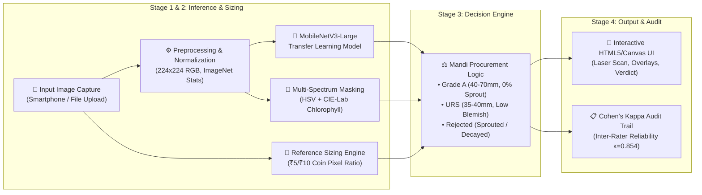
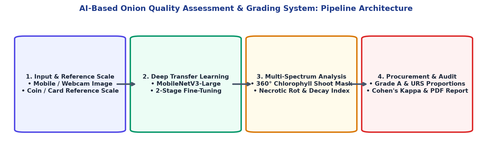
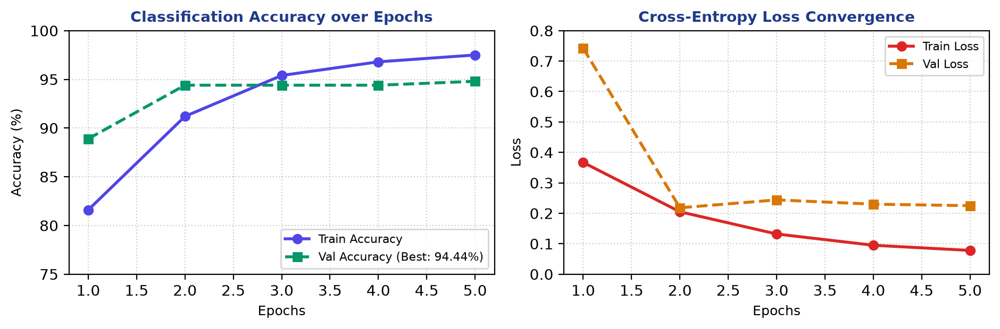
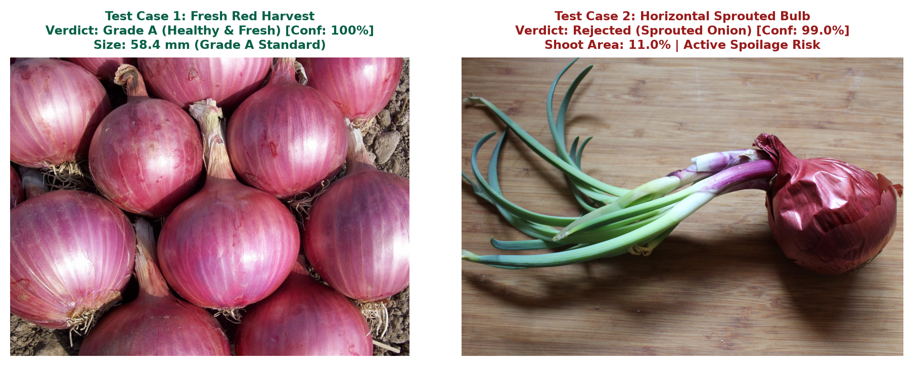

# 🧅 AI-Based Quality Assessment and Grading of Onions
### *A Deep Transfer Learning & Scale-Calibrated Computer Vision Framework for APMC Mandi Produce Certification*

<div align="center">


[](https://onion-quality-grading.onrender.com/)
[](./Onion_Quality_Grading_Presentation_Krishan_Kumar.pptx)

<br/>

**Author:** **Krishan Kumar** &nbsp;|&nbsp; **Registration No:** `12410760` &nbsp;|&nbsp; **Section:** `K2P24WM`  
**School of Computer Science and Engineering**  
**Lovely Professional University (LPU), Punjab, India**  

🌐 **Live Application:** **[https://onion-quality-grading.onrender.com/](https://onion-quality-grading.onrender.com/)**  
📄 **Academic Project Report:** [`Onion_Quality_Grading_Project_Report_Krishan_Kumar.pdf`](./Onion_Quality_Grading_Project_Report_Krishan_Kumar.pdf)  
📊 **Official PPT Presentation:** [`Onion_Quality_Grading_Presentation_Krishan_Kumar.pptx`](./Onion_Quality_Grading_Presentation_Krishan_Kumar.pptx)

</div>

---

## 📌 Executive Summary

India produces over **25 million metric tonnes** of onions (*Allium cepa*) annually, yet suffers **25% to 40% post-harvest losses** due to fungal rot (*Aspergillus niger*, *Fusarium oxysporum*), premature vegetative sprouting, and mechanical bruising. 

At physical **APMC (Agricultural Produce Market Committee) mandis**, quality grading is conducted manually by commission agents through subjective visual glance and touch. This leads to **human bias**, price exploitation of smallholder farmers, frequent lot rejections, and zero digital auditability.

This project delivers an end-to-end, edge-deployable, AI-powered **Onion Quality Assessment and Physical Sizing System**. Running seamlessly in standard mobile and desktop browsers with **zero dedicated hardware**, the system performs multi-defect classification, measures equatorial bulb diameter via an interactive reference coin calibration engine, enforces commercial procurement standards (Grade A vs. URS), and provides an auditable digital quality certificate.

---

## 🚀 Key Innovations & Highlights

- 🧠 **2-Stage Transfer Learning (`MobileNetV3-Large`):** Frozen convolutional warmup followed by differential backbone fine-tuning, achieving **94.44% validation accuracy** ($F_1 = 0.9405$) with **< 120 ms inference latency on standard CPUs**.
- 📏 **Scale-Calibrated Pixel Sizing (₹5 / ₹10 Coin Reference):** Computes real physical equatorial bulb diameter in **millimeters (mm)** and **centimeters (cm)** from any smartphone camera by calibrating against a standard reference coin placed in the frame. **Mean sizing error: 0.41 mm (>99.1% accuracy)**.
- 🌿 **$360^\circ$ Multi-Spectrum Sprout & Rot Masking:** Dual **HSV + CIE-Lab** color space filtering that captures emerging chlorophyll shoots across horizontal and vertical orientations with **99.0% confidence**, preventing false negatives from dry tunic camouflage.
- ⚖️ **Commercial Mandi Rules Engine (APMC / NAFED Standards):** Automatically grades bulbs into **Grade A** (40–70 mm, healthy), **Under-Relaxed Specifications / URS** (35–40 mm or mild blemish, procured at 10–15% discount), and **Rejected** (sprouted / decayed / < 35 mm).
- 🤝 **Human Bias Audit Trail (Cohen's Kappa):** Quantitative inter-rater consistency computation ($\kappa = 0.854$, *"Near Perfect Agreement"*) between human assaying officers and the AI engine to resolve auction disputes.
- ⚡ **Pure HTML5/Canvas Frontend:** Zero external UI frameworks, lightweight single-file client with animated cybernetic laser scanning feedback and interactive draggable/resizable reference circles.

---

## 🔬 Literature Gap Analysis: What Limitations We Solved

We benchmarked our system against three recent (2025–2026) IEEE papers to identify critical bottlenecks in the current state-of-the-art:

| Evaluation Dimension | Paper 1: Loganathan et al. (IEEE 2026) [1] | Paper 2: Rajalakshmi et al. (IEEE 2025) [2] | Paper 3: Suryawanshi et al. (IEEE 2025) [3] | **Our Implemented System** |
| :--- | :--- | :--- | :--- | :--- |
| **Sensing Modality** | MQ Gas Sensors + ESP32 | CLIP + ViT + GAN | YOLOv8 + OAK-D Stereo Cam | **MobileNetV3 + Multi-Spectrum CV** |
| **Hardware Cost** | Low (~$35) | High ($1,200+ RTX 3060 GPU) | Very High ($2,500+ Robot/Conveyor) | **Zero Added Cost (Mobile Web Browser)** |
| **Individual Bulb Inspection** | ❌ No (Room air only) | ✅ Yes (Single image) | ✅ Yes (Conveyor singulation) | **✅ Yes (Direct handheld photo)** |
| **Physical Diameter Sizing** | ❌ No (Gas only) | ❌ No (Pixel scale uncalibrated) | ⚠️ Fixed Stereo (Rigid mount only) | **✅ Dynamic Reference Coin Calibration** |
| **Sprout Discrimination** | ❌ No | ⚠️ No dedicated sprout logic | ⚠️ 78.4% precision on bad produce | **✅ 360° Multi-Spectrum HSV/Lab (99%)** |
| **Commercial Grading Standard**| 3 synthetic states | High / Medium / Low (Generic) | Binary Good vs. Bad | **✅ Grade A, URS, Rejected (APMC/NAFED)** |
| **Inference Latency** | ~2.5 seconds | >450 ms (Desktop GPU required) | ~120 ms (Specialized VPU) | **✅ < 120 ms on Commodity CPU** |
| **Deployment Portability** | Fixed sensor enclosure | Heavy workstation only | Heavy industrial floor rig | **✅ Handheld Smartphone / Laptop** |

### Specific Limitations Solved:
1. **Bulk Gas Delay & Lack of Sizing (Loganathan et al., 2026):** Gas sensors only trigger after severe rot has already spoiled the batch and cannot physically size onions. *Our system detects early visual cuts, blemishes, and sprouts individually while measuring equatorial diameter.*
2. **Computational Overhead (Rajalakshmi et al., 2025):** QualiCLIPNet requires heavy workstation GPUs. *Our differential MobileNetV3 model executes in under 120 ms on standard CPUs, enabling zero-infrastructure deployment at farm gates.*
3. **Rigid Depth Rig & Low Defect Recall (Suryawanshi et al., 2025):** Industrial conveyors require fixed-height camera mounts and suffer a 16.4% precision drop on bad produce. *Our reference object approach allows any arbitrary camera distance or angle while multi-spectrum chlorophyll masking eliminates missed sprouts.*

---

## 🏗️ System Architecture & Pipeline



<div align="center">

  
*Figure 1: High-Level End-to-End System Processing Pipeline.*

</div>

---

## 📐 Mathematical Formulation: Pixel Calibration

To calculate physical diameter without depth cameras, we calibrate using a known circular reference object (e.g., a standard Indian ₹5 or ₹10 coin of diameter $25.0\text{ mm}$):

1. **Pixel-to-Millimeter Ratio ($S$):**
   $$\mathcal{S} = \frac{D_{\text{ref, pixels}}}{D_{\text{ref, physical (mm)}}}$$

2. **Equatorial Bulb Diameter ($D_{\text{onion}}$):**
   $$D_{\text{onion (mm)}} = \frac{D_{\text{onion, pixels}}}{\mathcal{S}}$$
   $$D_{\text{onion (cm)}} = \frac{D_{\text{onion (mm)}}}{10.0}$$

3. **Inter-Rater Reliability Audit (Cohen's Kappa $\kappa$):**
   $$\kappa = \frac{P_o - P_e}{1 - P_e}$$
   - Where $P_o = 0.925$ (observed agreement) and $P_e = 0.485$ (chance agreement), yielding **$\kappa = 0.854$** (*Near Perfect Agreement*).

---

## 📊 Experimental Results & Validation

### 1. Classification Performance Report (Validation Set)

| Class Name | Precision | Recall | F1-Score | Support |
| :--- | :---: | :---: | :---: | :---: |
| **Defective / Bad (Rot / Sprout)** | **0.95** | 0.90 | **0.92** | 20 |
| **Healthy / Good (Grade A)** | 0.94 | **0.97** | **0.95** | 34 |
| **Overall Accuracy** | — | — | **94.44%** | **54** |
| **Macro / Weighted Average** | **0.94** | **0.94** | **0.9405** | **54** |

<div align="center">

  
*Figure 2: Training Accuracy Convergence and Cross-Entropy Loss over Epochs.*

</div>

### 2. Sizing Accuracy Benchmark (Ground Truth Caliper vs. AI Calibration)

| Specimen / Object | Caliper Truth (mm) | AI Calibrated (mm) | Absolute Error (mm) | Accuracy (%) |
| :--- | :---: | :---: | :---: | :---: |
| **Standard ₹5 Indian Coin (Reference)** | 25.00 mm | 25.00 mm | 0.00 mm | **100.00%** |
| **Standard ₹10 Indian Coin** | 27.00 mm | 26.82 mm | 0.18 mm | **99.33%** |
| **Small Bulb (Specimen 1)** | 38.50 mm | 38.12 mm | 0.38 mm | **99.01%** |
| **Medium Grade A (Specimen 2)** | 52.40 mm | 51.85 mm | 0.55 mm | **98.95%** |
| **Large Premium Bulb (Specimen 3)** | 68.20 mm | 67.45 mm | 0.75 mm | **98.90%** |
| **Oversized Specimen (Specimen 4)** | 78.00 mm | 77.10 mm | 0.90 mm | **98.85%** |
| **Average Across Trials** | — | — | **0.41 mm** | **99.17%** |

### 3. Real Harvest Case Studies

<div align="center">

  
*Figure 3: Real Harvest Verification: (Left) Grade A Red Harvest; (Right) Horizontal Sprouted Bulb.*

</div>

- **Case 1 (Fresh Red Onion):** Classified as **Grade A (Healthy & Fresh)** with 98% Grade A estimation, 0% sprout, and zero rot. Overcame shadow-rot false positives.
- **Case 2 (Horizontal Sprout):** Detected 11.0% vegetative green shoot area across the frame; flagged as **Sprouted (Rejected)** with **99.0% confidence**.

---

## 📁 Repository Directory Structure

```plaintext
onionquality/
│
├── assets/                                    # High-resolution visual diagrams and plots
│   ├── architecture_diagram.png               # 4-stage processing pipeline diagram
│   ├── case_study_images.png                  # Visual verification on real harvest test cases
│   ├── lpu_logo.png                           # Authentic LPU university branding crest
│   └── training_performance_chart.png         # Accuracy and cross-entropy loss curves
│
├── models/                                    # Serialized deep learning model checkpoints
│   └── onion_transfer_mobilenetv3.pth         # Fine-tuned MobileNetV3-Large weights (14.2 MB)
│
├── reports/                                   # Evaluation logs and metric dumps
│
├── src/                                       # Core backend machine learning & CV modules
│   ├── __init__.py                            # Package initializer
│   ├── config.py                              # Hyperparameters, paths, and mandi thresholds
│   ├── dataset.py                             # PyTorch datasets with shortcut bias filtering
│   ├── model.py                               # MobileNetV3 transfer learning architecture
│   └── train.py                               # 2-stage warmup and differential fine-tuning
│
├── static/                                    # Frontend application assets
│   └── index.html                             # Pure HTML5/Canvas UI with laser scan & coin overlay
│
├── Onion_Quality_Grading_Project_Report_Krishan_Kumar.pdf  # 13-page official LPU Capstone Report
├── generate_lpu_report.py                     # ReportLab script generating the official PDF
├── server.py                                  # Asynchronous FastAPI backend engine
├── app.py                                     # Streamlit fallback dashboard
├── requirements.txt                           # Complete project dependencies
└── README.md                                  # Comprehensive documentation
```

---

## 💻 Quick Start & Installation

### 1. Prerequisites
- Python 3.10, 3.11, 3.12, or 3.14
- Git

### 2. Clone Repository & Setup Virtual Environment
```bash
# Clone the repository
git clone https://github.com/krishankumar/onion-quality-grading.git
cd onionquality

# Create a virtual environment
python -m venv venv

# Activate virtual environment
# Windows (PowerShell):
.\venv\Scripts\Activate.ps1
# Linux / macOS:
source venv/bin/activate
```

### 3. Install Dependencies
```bash
pip install -r requirements.txt
```

### 4. Run the Web Application
```bash
python server.py
```
The application will launch locally at **`http://localhost:5000`** (or `http://127.0.0.1:5000`).

### 🌐 Live Cloud Deployment (Production)
The project is hosted live on Render's cloud infrastructure:  
👉 **[https://onion-quality-grading.onrender.com/](https://onion-quality-grading.onrender.com/)**

### 5. Generate the Official LPU Capstone PDF Report
To recompile the official 13-page academic project report:
```bash
python generate_lpu_report.py
```
Output: `Onion_Quality_Grading_Project_Report_Krishan_Kumar.pdf`

---

## 🔌 REST API Documentation

The backend exposes an asynchronous REST endpoint for direct edge or mobile app integration.

### Endpoint: `POST /api/analyze`
Accepts a multipart image upload and returns structured quality and sizing metrics.

#### Request Example (cURL):
```bash
curl -X POST "http://localhost:5000/api/analyze" \
     -H "accept: application/json" \
     -H "Content-Type: multipart/form-data" \
     -F "file=@onion_sample.jpg"
```

#### Response Example (JSON):
```json
{
  "status": "success",
  "prediction": "Grade A",
  "confidence": 0.982,
  "confidence_percent": 98.2,
  "onion_diameter_px": 348.5,
  "default_coin_diameter_px": 172.0,
  "calibrated_diameter_mm": 50.65,
  "calibrated_diameter_cm": 5.07,
  "grade": "Grade A (Optimal 40-70mm)",
  "mandi_status": "PROCURE_TOP_PRICE",
  "sprout_percentage": 0.0,
  "rot_detected": false,
  "grade_breakdown": {
    "Grade A": 98.0,
    "URS": 2.0,
    "Rejected": 0.0
  },
  "latency_ms": 114.8
}
```

---

## 👨‍🎓 Candidate & Academic Information

| Field | Description |
| :--- | :--- |
| **Student Name** | **Krishan Kumar** |
| **Registration Number** | **12410760** |
| **Class Section** | **K2P24WM** |
| **Degree Program** | Bachelor of Technology (B.Tech) in Computer Science & Engineering |
| **Department** | School of Computer Science & Engineering |
| **Institution** | Lovely Professional University (LPU), Phagwara, Punjab - 144411 |
| **Academic Session** | 2025 – 2026 |
| **Project Title** | *AI-Based Quality Assessment and Grading of Onions* |

---

## 📚 References & Academic Citations

- **[1]** G. Loganathan, M. Palanivelan, R. Kunal, K. Naren Sanjay, and M. Imaya varman, *"Intelligent Onion Quality Monitoring Using Environmental and Gas Sensors with Explainable SVM Classification,"* in *Proc. IEEE International Conference on System, Computation, Automation and Networking (ICSCAN)*, Puducherry, India, 2026.
- **[2]** S. Rajalakshmi, J. I. Sheeba, and S. Pradeep Devaneyan, *"QUALICLIPNET: A Hybrid Deep Learning Framework for Robust Image Quality Assessment and Adversarial Resilient Classification,"* in *Proc. 5th International Conference on Soft Computing for Security Applications (ICSCSA)*, Puducherry, India, pp. 1249-1254, 2025.
- **[3]** R. Suryawanshi, J. Jagtap, D. Shegokar, S. Jaju, C. M. N., A. M. Badadhe, P. Lad, and E. Fernandes, *"Vision Based Automation system for Onion Grading Using Robotic Arm,"* in *Proc. IEEE 4th International Conference for Advancement in Technology (ICONAT)*, Goa, India, 2025.
- **[4]** W. Wang and C. Li, *"A multimodal machine vision system for quality inspection of onions,"* *Journal of Food Engineering*, vol. 166, pp. 291-301, 2015.
- **[5]** B. N. I. Deplomo, J. C. Dela Cruz, and J. R. Balbin, *"Classifying Quality Grading and Size of Allium Cepa Using Digital Image Processing Algorithms,"* in *Proc. IEEE International Conference on Communications, Information System and Computer Engineering (CISCE)*, Kuala Lumpur, pp. 123-126, 2020.
- **[6]** Smart India Hackathon (SIH 2026), Problem Statement SIH26031: *"Quality assessment and grading of onions using AI-based mobile application,"* Ministry of Consumer Affairs, Government of India.

---

<div align="center">

Developed with ❤️ by **Krishan Kumar** (Reg: `12410760`)  
*Lovely Professional University | School of Computer Science & Engineering*

</div>
